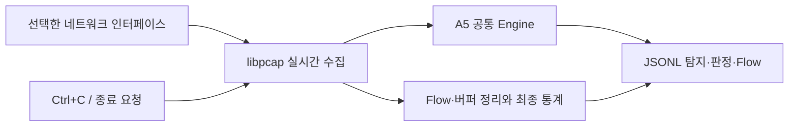

# A6 — 라이브 IDS 설계안

상태: 사용자 “A6 — 라이브 IDS 모드” 및 중단 작업 재개 지시에 따라 구현을 진행한다. 세부 기본값은 작성자 선택이며 사용자가 개별 승인했다고 주장하지 않는다. 독립 설계 검토는 중요한 미정 사항 없음으로 끝났다. 구현·라이브 테스트 완료는 별도 실제 증거로 판정한다.

실행 결과: 2026-11-08 완료. 최종 세 구성 각각238/238·실패/skip0·포맷 통과와 각 빌드의 격리망 실제11/11을 확인했다. 검증기 안전 우회 중요1건은 RED→GREEN으로 수정했고 경미3건은 [한계](../../known-limitations.md)에 보류했다. [A6 증거](../../a6-validation-2026-11-08.json)에 실제 범위를 기록한다. A7/AI는 시작하지 않았다.

## 목적과 기준

Linux 인터페이스에서 패킷을 수동 수집해 A5의 파서 → Flow → TCP → 룰 → JSONL 경로로 전달한다. 트래픽이 없는 동안에도 Ctrl+C로 정상 정리하고 가능한 libpcap 수신/유실 통계를 보고한다. live의 Drop은 계속 시뮬레이션이며 mode=live/enforced=false/actual_drop_packets=0이다.

기준은 PROJECT_SPEC F-01/F-06과 IMPLEMENTATION_PLAN A6다. 현재 HEAD는 `20be9aa51a16081e77bd6180a76412fe1ff134d8`, 작업 트리는 조사 시작 시 깨끗했다. A5는 세 구성 각각225/225를 검증했다. A6 시작 시 이 소스 해시와 회귀를 다시 대조하며 기존 커밋을 변경하지 않는다.

대상은 기존 Ubuntu/WSL Linux, C++20·libpcap·단일 스레드다. 현재 설치 libpcap은1.10.4다. `unshare --net -- /bin/true`가 성공해 임시 네트워크 namespace 생성 가능성만 확인했다. 실제 인터페이스 캡처, 패킷 주입, 권한 실패·신호 종료는 아직 검사하지 않았다.

A6만 수행한다. NFQUEUE/방화벽/실제 차단, 응용프로토콜, AI/IPC, 처리량 최적화, PCAP 저장, 로그 회전, 자동 재연결, 주기적 통계, 새 캡처 필터 CLI는 도입하지 않는다. **IPS A0~A8 → 사용자 자체 테스트 → 결과 확인과 AI 착수 지시 → B0**를 유지한다. 현재 AIPS 폴더에서 작업하고 자동 commit/push를 하지 않는다.

## 접근 방식

1. **제안: 비차단 libpcap + 제한된 대기 + 기존 Engine 동기 처리.** 입력 버퍼를 한 패킷씩 동기 소비해 기존 소유 결과를 발행한다. 기존 단일 처리 계약과 로그 장애 격리를 재사용하고, 대기 중 정지 요청도 확인할 수 있다.
2. 별도 캡처 스레드 + bounded queue는 향후 처리량 확장에 유리하지만 큐 포화·소유권·종료 동기화 정책이 추가된다. 불필요한 멀티스레딩을 피하는 현재 범위에는 맞지 않는다.
3. blocking pcap_loop와 신호만 사용하는 안은 장치·플랫폼별 깨우기 제약을 갖는다. 입력이 없는 종료까지 명확히 검증하기 위해1안을 제안한다.

1안은 작성자의 제안이며 사용자 승인으로 기록하지 않는다. 플랫폼/언어/룰 알고리즘은 기존 결정을 따른다.



## CLI와 사용자 동작

```bash
./build/miniips --mode live --interface eth0 --rules rules/example.json --log live-events.jsonl
./build/miniips --mode live --interface eth0 --log -
# 유한 재현/시험용: 파싱 실패를 포함한 수집 패킷10개 처리 후 정리
./build/miniips --mode live --interface eth0 --packet-count 10 --log -
```

- live에서는 --interface가 필수이고 --input은 금지한다. pcap에서는 --input이 필수이고 --interface/--packet-count는 금지한다. 중복/누락/잘못된 값과 inline 등 미지원 모드는 코드2다.
- --packet-count는 live 전용 선택 양의 uint64다. 생략하면 정지 요청까지 수집한다. 캡처 콜백에 전달된 모든 프레임이 한 건이며 parse_error도 포함한다. 이 값은 libpcap ps_recv나 룰 평가 수와 다르다.
- 룰·Flow/TCP/룰 상태 상한·로그 옵션은 A5와 동일하다. 인터페이스는 자동 선택하지 않는다. Linux 네트워크 인터페이스 이름의 길이와 NUL을 검사해 경로/거대한 문자열로 처리하지 않는다. any/cooked 등 비 Ethernet 장치는 명확히 거부한다.
- promiscuous 모드는 켜지 않는다. 명시한 인터페이스에서 보이는 프레임만 분석한다. VLAN/IPv6 등 파서 미지원 범위는 A1 계약과 같다.
- 검사 순서는 CLI → 룰/Engine 설정 → logger → live source 활성화다. 로그가 준비된 뒤 캡처 열기/권한/장치/링크 오류는 가능한 경우 engine_error와 aborted stats를 남긴다. 로그 초기화 이전 실패는 stderr다.
- live_ready 한 줄을 stderr에 flush해 인터페이스 활성화와 수집 준비 완료를 알린다. 활성화 경고가 있으면 별도로 진단한다. --log -의 stdout은 JSONL만 유지한다. --log PATH는 새 파일만 생성하며 기존 파일/링크 보호와0600 요청을 유지한다.
- --log가 없거나 파일이면 기존 human 렌더러를 재사용한다. live_summary, mode=live와 capture 통계를 표시한다. pcap의 기존 출력/오류 코드/기본값은 유지한다.
- SIGINT(Ctrl+C)/SIGTERM 또는 packet-count 도달은 정상 정지이며 검사/출력에 다른 실패가 없으면 코드0이다. 열기/수집/처리/출력 실패는1이다. 통계 API 미지원만으로 정상 정지를 실패로 바꾸지는 않는다.

## Live source와 대기 계약

새 live_pcap_source.hpp/.cpp에 Linux libpcap 핸들을 RAII로 소유하는 LivePcapSource를 둔다. 구성은 명시적 인터페이스와 선택 packet limit이다. API 이름의 세부는 구현자가 정하지만 다음 책임을 분리한다.

- 생성: pcap_create → snaplen262144/promisc0/read timeout100ms/immediate mode 설정 → pcap_activate → DLT_EN10MB 확인 → nonblocking 설정 → selectable fd 확인. 설정/활성화 실패는 예외와 안정된 오류 이유로 전달한다. 양의 activation warning은 진단하고 수집은 허용한다.
- run(PacketHandler, StopRequest): stop 요청과 packet limit를 매 패킷 사이에 확인하며 캡처 시각과 원본 길이를 포함한 PacketEnvelope를 동기 전달한다. callback이 끝나면 bytes 수명은 끝날 수 있다. PCAP 전체/실시간 패킷 큐를 쌓지 않는다.
- snapshot_stats(): 핸들이 열린 상태에서 pcap_stats를 읽어 소유 CaptureStats를 반환한다. 미지원/오류는 unavailable과 이유로 표현한다. close 뒤 조회하지 않는다.
- 소멸: 모든 정상/예외 경로에서 핸들을 정확히 한 번 닫는다. CLI가 source를 소유하므로 callback/처리 오류 뒤에도 닫기 전 통계를 시도할 수 있다. 생성 실패로 유효 핸들이 없으면 not_open이다.

pcap_next_ex는 nonblocking으로 사용한다. 1은 한 패킷,0은 현재 패킷 없음,-1은 오류다. live의 -2를 PCAP EOF로 해석하지 않고 예상하지 않은 수집 중단으로 실패 처리한다. 헤더 포인터/길이/snapshot 상한/캡처 시각 범위는 A1과 같은 방어 검사를 적용한다. 캡처 시각 변환은 필요한 만큼 내부 함수로 공유해 의미를 통일한다.

selectable fd가 없는 장치는 A6 Linux 구현에서 unsupported로 거부한다. 대기는 ppoll 또는 동일한 정밀도를 가진 Linux 대기로 최대100ms씩 한다. 매 대기 전 pcap_get_required_select_timeout을 다시 조회해 반환값이 있으면 더 짧은 제한을 적용하고, 대기 만료 때에도 nonblocking read를 시도한다. microsecond를 millisecond로 올림해 필수 대기 제한을 늘리지 않는다. EINTR는 정지 요청을 다시 확인하고, 잘못된 fd/장치 오류를 무한 재시도하지 않는다. 바쁜 수집 중에도 매 패킷 정지 확인을 생략하지 않는다.

required_select_timeout API를 사용하므로 CMake의 libpcap 최소 버전을1.9.0으로 올린다(현재1.10.4 충족). 외부 패키지를 자동 설치하지 않는다. 구버전 환경에서 빌드가 불가능해지는 비용을 README에 명시한다.

## 정지와 Engine 종료

SIGINT/SIGTERM의 처리기는 standalone main에서만 설치하고 기존 처리를 복구한다. 처리기는 volatile sig_atomic_t에 요청 신호를 기록하는 일만 한다. signal handler에서 로그·동적 할당·Engine·pcap_close를 호출하지 않는다. CLI/소스에는 일반 실행 문맥의 StopRequest callback을 전달한다. 라이브러리를 임베딩한 호출자는 직접 정지 요청을 제공하며 프로세스 신호 정책을 바꾸지 않는다. PCAP 모드의 SIGINT 의미는 이번에 바꾸지 않는다.

정지 요청이 패킷 처리 중 오면 현재 처리 결과를 발행하고 정리한다. 무입력 대기 구간의 정지 확인 주기는 최대100ms지만 처리/동기 로그/최종 정리 전체 지연 상한은 약속하지 않는다. 반복 정지 요청은 중복 종료 이벤트를 만들지 않는다.

EngineEnd와 FlowEndReason에 Stopped를 추가한다. 정상 live 중지는 flow reason=stopped이고 오류는 aborted다. TCP 종료는 관측 창 종료의 기존 CaptureEnd로 처리하되 외부 Flow stop_reason과 구별한다. finish는 모든 TCP/룰 배열을 해제하고 반복 호출의 수명 이벤트 중복 금지를 유지한다. EOF는 계속 PCAP 전용이다.

- 기존 capture_complete는 EOF 도달 여부여서 live에서는 정상 정지도 false다.
- live stats에만 run_complete를 추가한다. 생성 시점에 정상 요청/개수 정지로 처리 자체가 끝났으면 true, 캡처/처리/패킷별 human 출력 오류로 중단됐으면 false다. logger 실패와는 독립적이며 true가 전체 네트워크 검사 완료라는 뜻은 아니다. 이후 최종 human 요약/flush 실패까지 예측하지 않으며 최종 출력 성공은 종료 코드로 확인한다. 이 차이는 리뷰 경미 보류에 기록한다.
- stop_reason은 sigint/sigterm/packet_limit/error다. 통계 생성 이후 flush 오류는 run_complete를 소급 수정하지 않고 기존 최종 logger_summary/종료 코드로 보고한다.
- 처리 중 둘 이상의 종료 조건이 겹치면 처리 오류가 우선이고, 다음 정지 확인 시 이미 요청된 신호가 있으면 신호를 우선한다. 그 외 packet limit을 쓴다. 임베딩 요청에는 requested를 쓸 수 있다.

유휴 Flow 만료는 계속 실제로 받은 패킷의 캡처 watermark 기준이다. 트래픽이 없을 때 벽시계를 가짜 패킷 시각으로 넣어 Flow를 만료시키지 않는다. 따라서 무입력 중 상태는 유지되며 다음 캡처/정지에서 정리한다. 타이머 만료 정책 변경은 별도 기능이다.

## 공통 이벤트와 통계

EventContext에 CaptureMode(Pcap/Live, 기본Pcap)를 추가하고 serializer가 이를 mode로 기록한다. 잘못된 enum은 기존 직렬화 실패 경로로 처리한다. Publisher에는 기본값Pcap인 run publication context를 넘겨 현재 패킷·만료·종료·parse/error 모두 같은 모드를 사용한다. Engine의 룰 판정은 캡처 모드에 의존하지 않는다. pcap 호출부의 기본 의미와 JSON 출력을 유지한다. schema_version=1과 공통 키/null/ASCII·메시지·줄 상한은 유지한다.

live stats에는 source 정보·stop_reason·run_complete·capture_stats를 추가한다. capture_stats는 다음을 구분한다.

- status=available/unavailable/not_open, ps_recv/ps_drop/ps_ifdrop(raw 정수 또는 null), counter_bits, sample=before_close, 필요 시 제한된 오류 이유.
- ps_recv는 Engine packets_total과 동일하다고 가정하지 않는다. 버퍼에 남은 패킷과 플랫폼의 집계 의미가 다르다.
- ps_drop은 캡처 유실이고 simulated_drop_packets는 룰 판정이다. 실제 방화벽 차단은0이다. 두 Drop 집계를 합치지 않는다.
- ps_ifdrop=0이 드라이버 유실0 또는 미지원 중 무엇인지 단정하지 않고 availability=platform_dependent로 표시한다. API 호출 성공이 모든 필드 구현의 보증은 아니다.
- libpcap raw 카운터는 해당 네이티브 폭의 값이다. 장기 실행 wrap을 보정한64비트 누적치라고 주장하지 않는다. 실제 카운터 폭을 함께 기록한다.

인터페이스 이름·캡처 통계는 소유 메타데이터로 전달하고 source 핸들/버퍼를 Publisher에 넘기지 않는다. capture timestamp는 실제 캡처 시각만 사용하며 무입력 정상 중지의 timestamp는 null이다. 기존 논리적 탐지/발행 성공 수/로그 완료 의미도 유지한다.

## 라이브 로그 장애

A5의 최초 실패 고정·후속 미기록 집계 정책을 유지한다. live는 EOF가 없으므로 최초 장애를 가능한 즉시 stderr에 한 번 알리고 이후에도 신호/packet-count까지 판정한다. 종료할 때 실패 카운터와 log_complete=0, 코드1을 낸다. 실패한 logger로 engine_error를 재귀 기록하지 않는다.

stdout JSONL의 SIGPIPE와 모든 --log의 SIGXFSZ를 main에서 쓰기 오류로 바꾸는 A5 정책을 유지한다. human 출력/진단 스트림 실패는 기존처럼 중단할 수 있다. 동기 I/O 지연 상한·fsync 내구성·치명적 OOM 정리 보장은 이번에도 없다.

## 변경 범위

- 신규 live_pcap_source.hpp/.cpp와 소스 계약/구성 검증 테스트, live Engine 종료/Publisher 모드 테스트, 실제 live 프로세스 검사 스크립트.
- capture_source/pcap_source의 시각 검증 공유가 필요한 작은 연결 변경, engine의 Stopped 종료, event/logger/publisher 모드·live stats, cli/main의 옵션/정지/일반 처리 경로 연결.
- CLI는 PCAP와live가 동일한 inspect → render/publish → finish 경로를 사용하게 하되 입력 수집 어댑터를 분리한다. 전체 파이프라인을 두 벌로 복사하지 않는다.
- CMake/format 대상/libpcap 버전/테스트 등록과 README·설계 결정·알려진 한계·테스트 계획·A6 실행 증거를 갱신한다. A5 증거는 역사 기록으로 보존한다.
- A5 경미 보류3건은 연결상 필요한 변경이 아니라면 이번에 섞어 수정하지 않는다.

## 검증과 완료 기준

1. 구현 전 테스트를 작성해 실패 이유를 확인하고 이후 통과시킨다. 기존225개를 유지한다. 옵션 중복/상호 배타/packet-count 경계, 미지원 모드·링크, 정지 이유/반복 finish/메모리 정리, 이벤트7종의 live mode, empty live timestamp=null, stats unavailable와 카운터 의미를 검사한다.
2. 실제 통합은 root 또는 필요한 권한이 있는 Linux에서 **임시 익명 network namespace 안의 전용 veth 쌍**으로 수행한다. 수집기와 합성 프레임 송신기를 모두 그 안에 두고 외부 트래픽·사용자 호스트 인터페이스·방화벽을 변경하지 않는다. namespace 종료로 자원을 회수한다.
3. 전용 링크에 SYN·분할 payload·재전송·역방향·UDP/손상 프레임을 주입해 룰 탐지/판정과 JSONL을 재파싱한다. 그 링크를 막지 않고 프레임 수신과 enforced=false/actual_drop0을 확인한다. 실제 네트워크 차단 검사는 A7이다.
4. live_ready를 읽은 뒤 무입력 SIGINT와 SIGTERM, 프레임 burst 후 SIGINT와 packet limit, EOF 오표시 없음/flow stopped/메모리0, 파일/stdout/기존 파일 보호를 실제 프로세스로 확인한다. 테스트 watchdog로 중지 실패를 실패로 보고한다. 지속 부하 중 정지 회귀는 이번 실험으로 보장하지 않으며 경미 보류로 기록한다.
5. 닫힌 stdout/파일 크기 제한 후에도 뒤 패킷의 Drop/Pass 계산이 유지되고 종료 코드1/log_complete0인지 확인한다. 존재하지 않는 인터페이스와 권한 없는 자식 프로세스의 캡처 실패도 실제로 검사한다.
6. libpcap 수신/유실 통계를 실제 조회하되 ps_recv==processed나 ps_ifdrop0==무유실을 요구하지 않는다. 실제 캡처 버퍼 유실을 강제로 발생시켜 일정 값을 보장하는 성능 실험은 하지 않는다. stats unavailable의 출력 의미는 소유 값/Publisher 테스트로 검사하고 실제 미지원 장치 주입은 미실행으로 구별한다.
7. 일반 CTest는 권한 없는 환경에서도 가능한 단위/PCAP 회귀를 수행한다. 권한이 필요한 live 프로세스 검사는 별도 명시 명령으로 세 빌드에 실행한다. 권한 부족을 성공/skip0으로 위장하지 않으며 실제 통합을 못 돌리면 A6 인수는 미완료다. 추가 이름/개수는 실제 결과로 기록한다.
8. Debug·Release/clang-tidy·ASan/UBSan, 포맷, JUnit/명령/소스·입력·로그 해시와 최종 독립 코드 리뷰를 기록한다. 실제 live 입력→기존 Engine→로그, 무입력 정지, 수신/유실 통계 조회와 실패 정책을 재현한 뒤에만 A6 완료로 표시한다.

## 확인한 자료

- 설치 libpcap1.10.4의 pcap_get_selectable_fd/pcap_get_required_select_timeout man page와 pcap-config를 확인했다.
- [공식 selectable fd](https://www.tcpdump.org/manpages/pcap_get_selectable_fd.3pcap.html), [필수 대기 timeout](https://www.tcpdump.org/manpages/pcap_get_required_select_timeout.3pcap.html), [immediate mode](https://www.tcpdump.org/manpages/pcap_set_immediate_mode.3pcap.html).
- [libpcap1.10.4 nonblocking 계약](https://raw.githubusercontent.com/the-tcpdump-group/libpcap/libpcap-1.10.4/pcap_setnonblock.3pcap), [통계 의미](https://raw.githubusercontent.com/the-tcpdump-group/libpcap/libpcap-1.10.4/pcap_stats.3pcap), [breakloop의 플랫폼별 깨우기 조건](https://raw.githubusercontent.com/the-tcpdump-group/libpcap/libpcap-1.10.4/pcap_breakloop.3pcap).

## 작성자 선택과 남은 승인

제안 선택: 단일 스레드 비차단 수집, 명시적 인터페이스·promisc off, 선택 packet-count, 정상 Stopped/EOF 분리, 원시 캡처 통계의 모호함 표시, logger 실패 후 요청 정지까지 계속, capture timestamp 기반 만료 유지, libpcap 최소1.9.0, 익명 namespace 검증. 이는 사용자에게 이미 승인받은 세부 사항으로 간주하지 않는다.

사용자의 작업 재개 지시에 따라 위 기본값으로 진행하고 예상과 다른 결과는 문서·검증에 명시한다. 실제 테스트용 호스트 인터페이스 이름은 요구하지 않으며 구현 검증에는 격리된 전용 링크를 사용한다.
